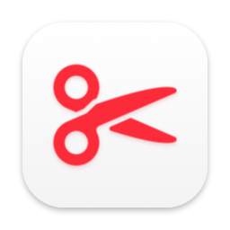

<p align="center">
  
</p>

<h1 align="center">SnipGo</h1>

<p align="center">
  轻量的 macOS 菜单栏截图工具：截图 · 多屏 · 取色 · 圈图标注 · 马赛克 · 识字 · 翻译 · 滚动长图 · 钉图 · 录视频
</p>

<p align="center">
  
  
  
</p>

---

## 功能

| 功能 | 说明 |
|---|---|
| 📸 **截图** | 拖拽选区，或单击直接选中窗口；方向键微调，选区按 Retina 像素对齐导出 |
| 🖥 **多屏截图** | 选区可以拖到另一块屏幕，也可以横跨多块屏幕，导出为一张图；`⌘A` 一键选中所有屏幕；屏幕清晰度不同时按清晰度高的那块导出 |
| 🎯 **取色器** | 还没选区域时鼠标旁显示放大镜，显示周围像素、坐标和颜色；`C` 复制颜色，`⇧` 切换 HEX / RGB |
| ✏️ **圈图标注** | 矩形、椭圆、直线、箭头、画笔、文字，可选 3 档粗细和 8 种颜色，⌘Z 撤销；标注可以画过屏幕交界 |
| 🔲 **马赛克** | 画笔式涂抹打码，屏幕上看到的效果就是导出的效果 |
| 🔤 **识别文字** | 系统 Vision 离线识别简体 / 繁体中文、英文、日文、韩文，自动按行、段落、分栏排版；结果可编辑、复制 |
| 🌐 **翻译** | 系统翻译框架，离线、免费；原文和译文左右对照，可切换目标语言；默认中文→英文、其他→简体中文 |
| 📜 **滚动长图** | 选区后手动滚动页面，自动拼接；能识别吸顶导航和吸底栏，右侧实时预览 |
| 📌 **钉图** | 把截图钉在桌面最上层（全屏应用里也能看到），可拖动，滚轮或触控板捏合缩放 |
| 🎬 **录视频** | QuickTime 风格的底部控制条，录整个屏幕或所选部分，输出 mp4（H.264），可录系统声音和麦克风 |
| ⚙️ **偏好设置** | 开机自启、提示音、jpg/png、自定义快捷键（附设置方法说明）、文件名前缀、保存位置；「关于」页含版本与项目信息 |

## 安装

需要 **macOS 15 或更高版本**。

### 方式一：安装包

下载 [Resources/SnipGo-1.1.1.dmg](Resources/SnipGo-1.1.1.dmg)，打开后把 SnipGo 拖到「应用程序」。

> 安装包使用 ad-hoc 签名，没有经过 Apple 公证。第一次打开时如果系统提示无法验证开发者，请在 **系统设置 › 隐私与安全性** 中点「仍要打开」，或在「应用程序」里右键 SnipGo 选择「打开」。

### 方式二：从源码编译

需要安装 Xcode（Swift 6 工具链）。

```bash
git clone https://github.com/Conlin-Git/SnipGo.git
cd SnipGo
./scripts/build.sh --install   # 编译并安装到 /Applications（会删除 build 中的副本）
open /Applications/SnipGo.app
```

第一次使用时，需要在 **系统设置 › 隐私与安全性 › 屏幕与系统录音** 中允许 SnipGo，然后重新打开应用。录制麦克风时会另外申请麦克风权限。识字和翻译不需要额外权限；第一次翻译某种语言时，系统会提示下载语言包（之后离线可用，可在 **系统设置 › 通用 › 语言与地区 › 翻译语言** 中管理）。

> 打包脚本会优先使用本机的 Apple Development 证书签名，这样重新编译后不需要再次授权；没有证书时退回 ad-hoc 签名。

## 使用

SnipGo 常驻菜单栏（剪刀图标），所有功能都可以从菜单栏菜单或快捷键进入。

### 快捷键

| 操作 | 快捷键 |
|---|---|
| 截图 | `⌘⇧1` |
| 新建录屏；录制中再按一次停止 | `⌘⇧2` |
| 复制到剪贴板 | `↩` / `⌘C` / 双击选区 |
| 保存到文件 | `⌘S` |
| 选中所有屏幕 | `⌘A` |
| 复制鼠标处的颜色 / 切换 HEX、RGB | `C` / `⇧` |
| 撤销标注 | `⌘Z` |
| 微调选区（按住 `⇧` 每次移动 10pt） | 方向键 |
| 取消 | `Esc` / 右键 |

两个全局快捷键都可以在「偏好设置」中修改：点击快捷键框，直接按下新的组合键。组合键需包含 `⌘`、`⌃`、`⌥` 之一，也可以单独使用 `F1`–`F12`（Mac 键盘上即 `fn`+`F1`…`F12`）；按 `Delete` 清除，按 `Esc` 取消。

### 截图与标注

1. 按 `⌘⇧1`，拖拽出一个选区，或者单击选中某个窗口。选区可以拖到另一块屏幕，或直接横跨多块屏幕；按 `⌘A` 选中所有屏幕。
2. 在选区下方的工具栏里选择标注工具，下面一行可以切换粗细和颜色。
3. 点 **复制** 或 **保存** 完成；点选区右上角的 **📌** 可以把截图钉在桌面上。

### 取色

按 `⌘⇧1` 后先不要选区，移动鼠标，旁边的放大镜会显示鼠标所在像素的颜色。按 `C` 复制颜色并退出截图，按 `⇧` 在 HEX（如 `#1A2B3C`）和 RGB 之间切换。

### 识别文字与翻译

1. 截图选好区域后，点工具栏里的 **识别文字** 或 **翻译**。
2. 识别结果在浮动面板中显示，可以直接修改、复制；点 **翻译** 切换为原文 / 译文对照，右上角选择目标语言。
3. 原文改过后点 **重新翻译**；`Esc` 或 `⌘W` 关闭面板，没选中文字时 `⌘C` 复制全部内容（翻译模式下复制译文）。

> 识字和翻译都在本机完成，不会上传截图。艺术字、手写字识别率较低，结果可以手动修正。

### 滚动长图

1. 截图选好区域后，点工具栏里的 **长截图** 按钮。
2. 像平时一样向下滚动页面，右侧会实时显示拼接结果。
3. 在工具栏中选择 **复制 / 保存 / 钉图**。

> 滚动太快、或者两帧之间全是空白时会接不上，放慢速度继续滚动即可；向上滚动的帧会被自动忽略。长截图按显示器采集画面，选区需要在同一块屏幕内。

### 钉图

| 操作 | 方式 |
|---|---|
| 移动 | 拖动 |
| 缩放（10%–800%） | 滚轮、触控板捏合，或 `+` / `-`；`0` 恢复 100% |
| 复制 / 保存 | `⌘C` / `⌘S` |
| 关闭 | 双击或 `Esc` |
| 更多操作 | 右键菜单（含「关闭所有钉图」） |

### 录视频

1. 按 `⌘⇧2`，屏幕上会预先选好一块区域，可以直接拖动调整。
2. 在底部控制条中选择 **录制整个屏幕** 或 **录制所选部分**，在 **选项** 里开关麦克风、系统声音和鼠标指针。
3. 点 **录制** 开始。要结束时，单击菜单栏里的 ⏹ 计时按钮，或者再按一次 `⌘⇧2`。录好的 mp4 会在 Finder 中自动选中。录屏一次只录一块屏幕。

## 项目结构

```
SnipGo/
├── Package.swift
├── Resources/              Info.plist、图标源图、安装包 SnipGo-<版本>.dmg
├── scripts/
│   ├── build.sh            编译 → 组装 .app → 生成图标 → 签名（--install 安装）
│   └── make_icon.swift     生成 AppIcon.icns
├── Sources/
│   ├── SnipCore/           纯算法，可单测：长图拼接、OCR 排版、取色颜色格式
│   └── SnipGo/
│       ├── Capture/        冻结屏幕、遮罩窗口、跨屏共享画布、选区与取色器、工具栏、流程调度
│       ├── Editor/         标注模型与渲染（含马赛克）
│       ├── Scroll/         长截图会话（SCStream 采帧 + 实时预览）
│       ├── Record/         录屏会话（SCRecordingOutput）与底部控制条
│       ├── OCR/            文字识别与识别 / 翻译结果面板
│       ├── Pin/            钉图窗口
│       ├── Preferences/    SwiftUI 偏好设置、快捷键录制控件
│       └── Output/         保存、剪贴板、提示音
├── Tests/SnipCoreTests/    拼接、排版、取色单元测试
└── docs/                   技术方案.md、OCR与翻译方案.md
```

## 技术要点

- **截屏**：用 ScreenCaptureKit 的 `SCScreenshotManager` 冻结每块屏幕，用 `CGWindowListCopyWindowInfo` 按前后顺序识别窗口。
- **跨屏选区**：每块屏幕一个遮罩窗口，所有屏幕共享一个 `CaptureCanvas`，选区和标注统一使用全局坐标；跨屏导出时逐屏绘制冻结图，按最高像素密度合成一张图。
- **取色**：按物理像素从冻结图取样并转换为 sRGB。
- **识字与翻译**：Vision `VNRecognizeTextRequest` 识字，`SnipCore/TextLayout` 负责分栏、分行、分段（避免拆散表格）；翻译用系统 Translation 框架（SwiftUI `.translationTask`），原文语言交给框架自动检测，避免中英混排时翻错。
- **长图拼接**：每行提取 32 个列块的亮度特征，在中间区域枚举位移，选出不匹配行最少的那个；自动识别并保留吸顶和吸底区域；新增的条带单独拷贝保存，避免内存随帧数膨胀。
- **录屏**：`SCStream` 配合 `SCRecordingOutput` 直接写 mp4，像素尺寸取偶数，帧率 60fps。
- **全局快捷键**：Carbon `RegisterEventHotKey`，不需要辅助功能权限。

更多设计细节见 [docs/技术方案.md](docs/技术方案.md) 和 [docs/OCR与翻译方案.md](docs/OCR与翻译方案.md)。

## 开发

```bash
swift build          # 调试编译
swift test           # 运行单元测试（长图拼接、OCR 排版、取色格式）
./scripts/build.sh   # 打包为 build/SnipGo.app
```
